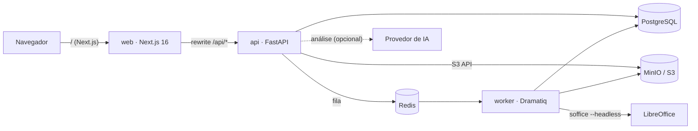

# Arquitetura

## Visão geral

Monólito modular (uma base de código de backend, dois processos: `api` e `worker`), com adaptadores nas bordas para que regra de negócio não dependa de provedor nenhum.

- **web**: Next.js (App Router), TipTap para o editor, TanStack Query/Virtual, React Hook Form + Zod. Fala só com a própria origem; `/api/*` é reescrito para a API (cookies simples, sem CORS).
- **api**: FastAPI síncrono (threadpool), SQLAlchemy 2, Pydantic. **Sem estado em memória**: sessão, idempotência e fila vivem no banco/Redis; qualquer instância atende qualquer requisição.
- **worker**: mesmo código; executa jobs de geração (DOCX → PDF via LibreOffice) e análises. Escala horizontalmente (`docker compose up --scale worker=3`).

## Módulos do backend (`backend/app`)

| Módulo | Responsabilidade |
|---|---|
| `core/` | configuração, erros padronizados, logs estruturados (correlation ID, redação de PII), segurança (Argon2, HMAC), rate-limit, métricas |
| `db/` | tipos portáveis (PostgreSQL/SQLite), modelos SQLAlchemy |
| `docx_engine/` | **motor DOCX** puro (sem banco): validação de segurança, parse → blocos, compilação de gabarito, renderização |
| `modules/auth` | cadastro, login, sessões, recuperação de senha |
| `modules/generators` | CRUD de geradores, painel |
| `modules/templates` | upload, versões, documento do editor, publicação |
| `modules/fields` | tipos, validadores brasileiros, normalização/formatação, CRUD |
| `modules/suggestions` | regras determinísticas + IA/local, revisão (aceitar/ignorar) |
| `modules/generation` | jobs (individual/lote), runner, importação/planilha-modelo, nomes de arquivo, downloads |
| `modules/kits` | kit de documentos: campos compartilhados entre geradores, mapeamento, detecção automática por similaridade de rótulo ou, opcionalmente, por classificação semântica de papéis via TypeSafe.ai/Jev (`matching.py`, `adapters/ai/typesafe.py`; ver [D25](DECISIONS.md)), execução (cria um `generation_jobs` por documento membro — sem runner próprio, ver [D24](DECISIONS.md)) |
| `adapters/` | `storage` (local/S3), `pdf` (LibreOffice), `ai` (local/API), `queue` (dramatiq/thread/sync), `notify` (SMTP/console) |

Regras: routers só delegam a serviços; serviços recebem um `Ctx` (usuário + workspace) e **toda consulta filtra por `workspace_id`**; adaptadores nunca importam serviços.

## O motor DOCX (o ponto de maior risco)

1. **Original imutável.** O `.docx` enviado é guardado byte a byte (SHA-256, chave aleatória).
2. **Parse → blocos.** Cada parágrafo (corpo, células de tabela, cabeçalhos, rodapés) ganha chave estável (`body/p3`, `body/t1/r2/c2/p1`, `header1/p1`). O conteúdo vira nós inline: texto com marcas, `field`, `docAtom` (imagem, quebra de página, campo do Word) e `hardBreak`.
3. **Editor.** O TipTap edita esse modelo. Um campo guarda `fieldId` + `sample` (o texto que ele substituiu).
4. **Âncoras.** Ao salvar, o servidor recalcula `field_occurrences`: bloco + offsets + trecho + contexto antes/depois. Se o arquivo é substituído, as ocorrências são *re-ancoradas* por trecho+contexto; o que não achar fica marcado "não está no documento".
5. **Compilação** (`compile_docx`): só parágrafos **modificados** são reconstruídos, mapeando cada caractere novo ao run de origem (`difflib`) para herdar a formatação; cada ocorrência de campo vira **um run com um token** `⟦F:<nonce>:<nome>⟧`. Não modificados ficam idênticos ao original (há teste comparando o XML).
6. **Renderização** (`CompiledTemplate.render`): troca o run-token pelo valor formatado (quebras de linha viram `w:br`). Não há substituição de string atravessando runs.
7. **PDF**: `LibreOfficeConverter` (perfil por thread, várias conversões por invocação, fallback item a item, timeout com kill do grupo de processos, verificação de `%PDF-`).

## Fluxo de dados

**Criar um gerador**: `POST /generators` → `POST /generators/{id}/template` (valida ZIP/OOXML, parse, blocos; a versão criada já vira `current_version_id` do gerador) → fila `analysis` → sugestões → editor (`GET /editor`, autosave `PUT /editor/content` com `revision`). Sem etapa de publicação: salvar já deixa pronto para `/generate`/`/batches`, que compilam a versão atual sob demanda (cache em `compiled_file_id`/`compiled_revision`, ver [D23](DECISIONS.md)).

**Versões**: histórico completo, mas sempre uma única "atual" por gerador (`document_generators.current_version_id`). Enviar um novo `.docx` ou restaurar uma versão antiga (`POST /versions/{id}/restore`) cria uma linha nova em `template_versions` e troca o ponteiro; nada é sobrescrito.

**Gerar** (individual ou lote): a API valida (autoridade de validação), cria `generation_jobs` + `generation_items` (com `idempotency_key`), enfileira e responde 202. O worker executa `run_generation_job` (idempotente, item a item), atualiza progresso, monta ZIP + relatório CSV. O cliente acompanha por polling e baixa por link assinado curto.

**Kit de documentos**: agrupa geradores existentes que compartilham variáveis (nome, CPF, endereço…) atrás de **um** formulário. `POST /kits/{id}/runs` valida os valores de cada documento membro e cria **um `generation_jobs` comum por membro** (`kit_run_id` os agrupa) — o runner/worker/watchdog não mudam. O status do `kit_run` é sempre **derivado** dos status dos jobs membros (nunca armazenado); ZIP consolidado e relatório CSV são `generated_files` comuns pendurados no `kit_run_id` (mesmo link assinado dos jobs individuais). Ver [D24](DECISIONS.md).

## Jobs, confiabilidade e falhas

- **Isolamento por item**: erro em uma linha marca só o item (`failed`); o lote termina `partial`.
- **Idempotência**: mesma `Idempotency-Key` devolve o mesmo job (`UNIQUE(workspace_id, idempotency_key)`); `run_generation_job` pula itens `succeeded` e remove arquivos parciais antes de refazer.
- **Retry só para falhas transitórias** (`TransientError`: storage/rede). Falhas permanentes de item não repetem. Esgotadas as tentativas, a mensagem vai para a *dead-letter* do broker e o job vira `failed` (`RETRIES_EXHAUSTED`).
- **Queda do worker (SIGKILL/OOM/host)**: o executor grava um *heartbeat* no job a cada 10 s; um watchdog reenfileira o job sem heartbeat há 60 s (ou `queued` há 5 min) e o runner idempotente retoma dos itens pendentes, sem duplicar arquivos. A posse é atômica (`claim_job`): mensagens duplicadas do broker viram no-op e um executor que perdeu a posse para (ver [D22](DECISIONS.md)). Verificado com `docker kill` no worker em um lote real: retomou sozinho em 94 s e 101 s (duas execuções). Não depende do redelivery do Dramatiq (probabilístico).
- **Limite conhecido**: a entrega é *at-least-once*; um job só fica para sempre em `processing` se todos os workers ficarem fora do ar — ao voltarem, o watchdog o retoma.
- **Timeouts**: IA (config), LibreOffice (config, mata o grupo de processos), job (limite do Dramatiq).
- **Retenção**: `generated_files.expires_at`; `python -m app.cli cleanup` remove do storage.

## Escalabilidade (sem Kubernetes)

API sem estado · arquivos fora do disco (S3) · fila separando web de processamento pesado · workers horizontais · paginação e índices · limites por workspace (`workspaces.limits`) · adaptadores para storage/PDF/IA/notificação · módulos com fronteiras claras para extração futura. A conversão em lotes de N arquivos por invocação do LibreOffice é o que torna 1.000 PDFs viáveis (medido ≈ 90 ms/doc no worker).

## Observabilidade

- Logs JSON com `request_id` (cabeçalho `X-Request-ID`) e `job_id`; filtro que mascara CPF/CNPJ/e-mail/telefone.
- `/health` (liveness), `/ready` (banco + conversor), `/metrics` (Prometheus, agregado do banco: jobs por status, itens, falhas por código, duração média, bytes); o worker expõe as métricas de fila do Dramatiq na porta 9191.
- Auditoria (`audit_events`) de upload, publicação, geração, download e exclusão, sem conteúdo sensível.
