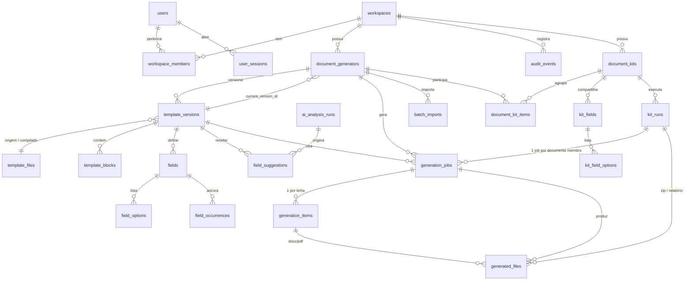

# Modelo de dados

PostgreSQL 17 (JSONB), migrations Alembic (`backend/migrations`). Tipos portáveis: os testes rápidos usam SQLite com o mesmo modelo.

## Tabelas (resumo)

| Tabela | Função | Observações |
|---|---|---|
| `users`, `auth_identities`, `password_reset_tokens`, `user_sessions` | identidade | senha Argon2 (nula p/ login social); tokens só como SHA-256; sessão com CSRF |
| `workspaces`, `workspace_members` | tenant e papéis (`owner`/`member`) | `workspaces.limits` (JSONB) sobrescreve limites padrão |
| `document_generators` | o gerador | `status` active/archived; `is_pinned` (fixar no painel); `current_version_id` (versão em uso — sem rascunho/publicação, ver [D23](DECISIONS.md)); `deleted_at` (soft delete) |
| `template_files` | arquivos **imutáveis** (origem e compilado) | `sha256`, chave S3 aleatória, tamanho |
| `template_versions` | histórico de versões (cada upload/restauração cria uma linha; nunca é editada retroativamente) | `revision` (concorrência otimista do editor); `compiled_file_id`/`compiled_revision` (cache do gabarito compilado, recalculado quando `revision` muda) |
| `template_blocks` | parágrafos/tabelas do documento | `key` estável, `container_key`, `ordinal`, `content` (JSONB inline), `text`, `source_text`, `origin` (original/inserted) |
| `fields`, `field_options` | campos e listas | `UNIQUE(version_id, name)`; opções `UNIQUE(field_id, value)`; `config` (JSONB) só p/ parâmetros variáveis por tipo |
| `field_occurrences` | **âncoras** | bloco + offsets + trecho + contexto (80 chars) + `status` |
| `ai_analysis_runs`, `field_suggestions` | análise e revisão | cache por hash; sugestões com estado (pending/accepted/ignored) |
| `generation_jobs`, `generation_items`, `generated_files` | geração | `idempotency_key` único por workspace; snapshot dos campos usado; expiração dos arquivos; `attempts` + `heartbeat_at` (posse e detecção de worker morto — ver D22) |
| `batch_imports` | planilha enviada aguardando mapeamento | expira em 1 h |
| `audit_events` | auditoria | sem conteúdo sensível; índice (workspace, data) |
| `document_kits` | o kit (coleção de geradores) | `status` active/archived; `is_pinned`; `deleted_at` (soft delete) — mesmo padrão de `document_generators` |
| `document_kit_items` | um gerador dentro do kit | `UNIQUE(kit_id, generator_id)`; `field_mapping` (JSONB: `{campo_do_kit: campo_do_gerador}`) |
| `kit_fields`, `kit_field_options` | campos compartilhados do kit e suas listas | mesmo vocabulário de tipos de `fields`; `UNIQUE(kit_id, name)` |
| `kit_runs` | uma geração do kit | **sem coluna de status** — sempre derivado dos `generation_jobs` do run (ver [D24](DECISIONS.md)); `idempotency_key` único por workspace; `values_snapshot` (JSONB) |

`generation_jobs.kit_run_id` (FK opcional) marca os jobs criados por um kit; `generated_files.job_id` agora é **anulável** e ganhou `kit_run_id` (FK opcional) com `CHECK (job_id IS NULL) != (kit_run_id IS NULL)` — o ZIP e o relatório CSV do kit são `generated_files` comuns pendurados no run, não no job.

## Decisões de normalização

- **Normalizado**: tudo que se consulta ou tem integridade própria — campos, opções, ocorrências, blocos, jobs, itens, arquivos.
- **JSONB somente onde a estrutura é realmente variável**: conteúdo inline de um bloco (texto + marcas + nós de campo), valores de uma linha de lote (colunas dependem do gerador), sugestões brutas da IA, `config` por tipo de campo, metadados de auditoria e o *snapshot* dos campos usados numa geração.
- **Blocos em linhas, não um JSON gigante**: permite atualizar só o parágrafo alterado, indexar por versão/contêiner e recalcular âncoras sem reescrever o documento.
- **Snapshot no job** (`fields_snapshot`): repetir uma geração usa exatamente as definições daquele momento, mesmo que a versão atual mude depois.
- **Hash de análise** (`ai_analysis_runs.file_sha256`): hash do arquivo + texto analisado. Mesmo hash + mesmo provedor/versão de prompt ⇒ reaproveita o resultado sem nova chamada de IA.

## Índices relevantes

`document_generators(workspace_id, status, deleted_at)` · `template_blocks(version_id, container_key, ordinal)` · `fields(version_id, position)` · `field_occurrences(field_id)` e `(version_id, ordinal)` · `generation_jobs(workspace_id, created_at)`, `(workspace_id, status)` e `(status, heartbeat_at)` · `generation_items(job_id, status)` · `generated_files(job_id)`, `(kit_run_id)` e `(expires_at)` · `audit_events(workspace_id, created_at)` · `document_kits(workspace_id, status, deleted_at)` · `document_kit_items(kit_id, position)` · `kit_fields(kit_id, position)` · `kit_runs(workspace_id, created_at)` · `generation_jobs(kit_run_id)` · `UNIQUE generation_jobs(workspace_id, idempotency_key)` · `UNIQUE kit_runs(workspace_id, idempotency_key)`.

## Multi-tenant

Todas as tabelas de domínio têm `workspace_id`; os serviços exigem o `workspace_id` do contexto autenticado em cada consulta (`core.get_generator`, `get_version`, `get_file`, …). Recurso de outro workspace responde **404** (não 403). Há teste automatizado com dois workspaces cobrindo 28 chamadas e o download assinado.
