# Roteiro de demonstração

Pré-requisito: `docker compose up --build` concluído (ou o modo local do README). Arquivos de exemplo em `demo/` (dados **fictícios**).
Capturas de tela em `docs/screenshots/` (geradas por `CAPTURE_SCREENSHOTS=1 npx playwright test e2e/capture-screenshots.spec.ts`):

| | |
|---|---|
| 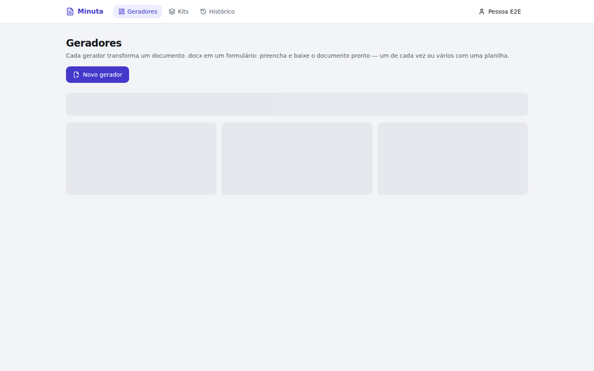 | 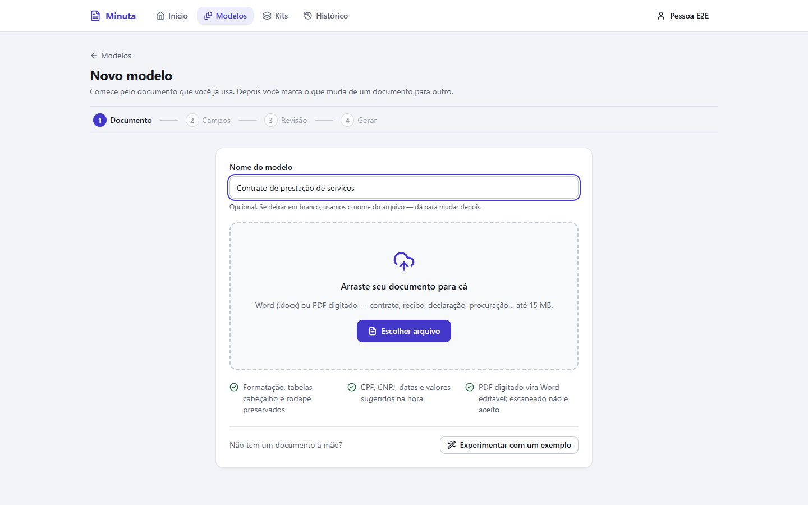 |
| 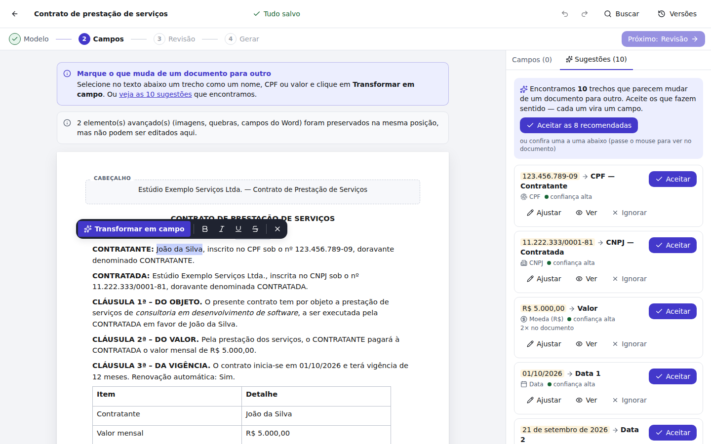 | 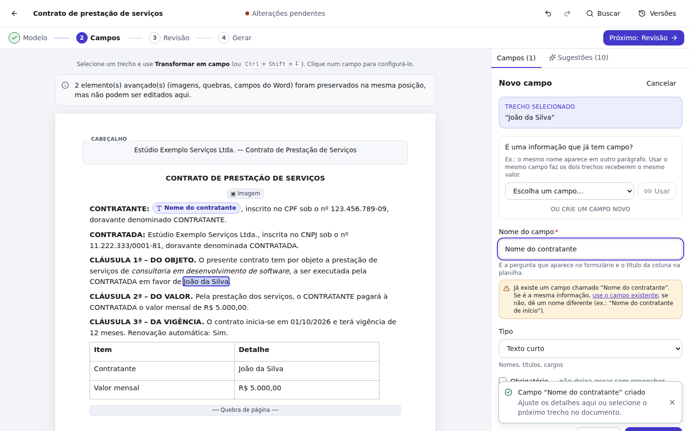 |
| 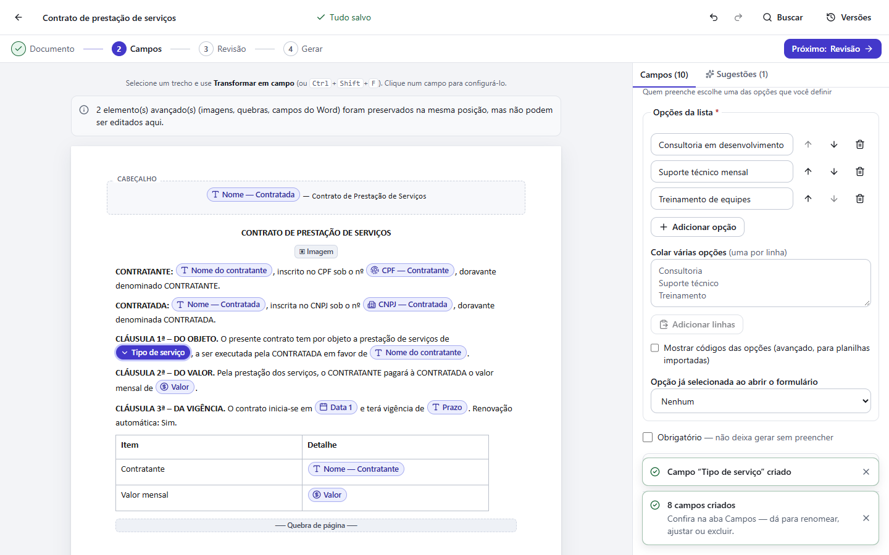 | 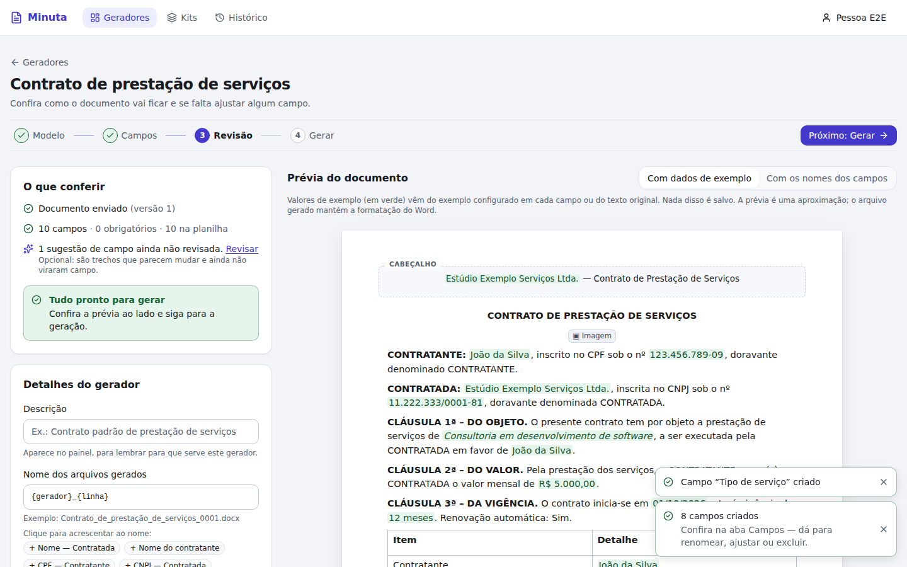 |
| 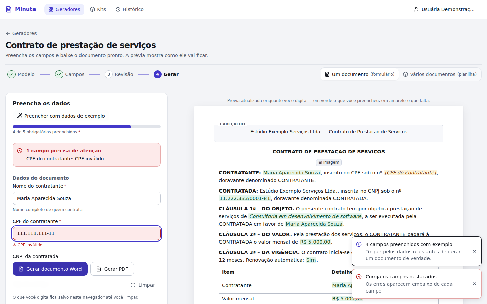 | 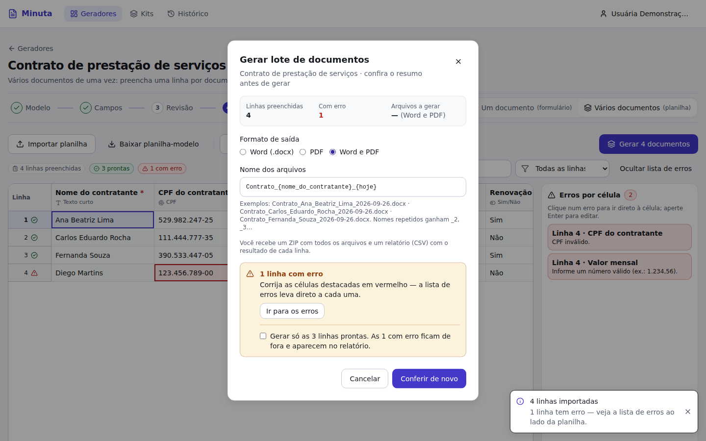 |
| 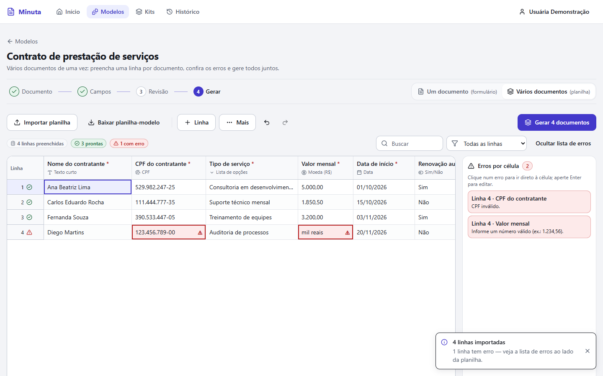 | 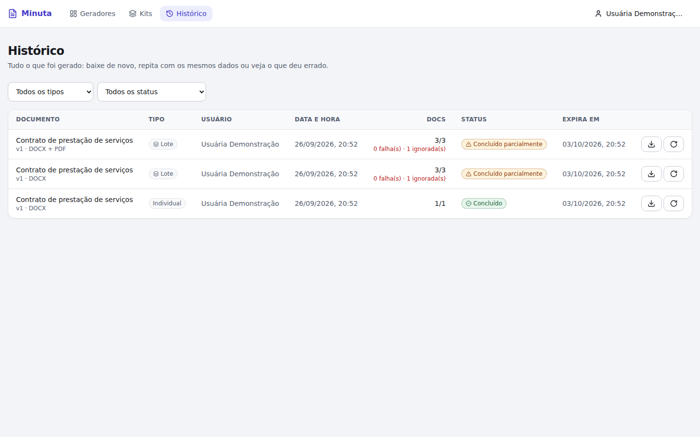 |
| 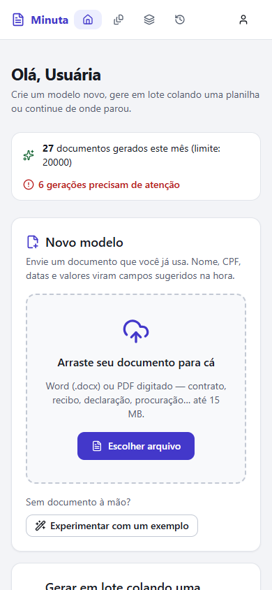 | |

Todo modelo tem as mesmas **4 etapas**, visíveis no topo de cada tela: **Documento → Campos → Revisão → Gerar**. (O que antes se chamava "gerador" agora é "modelo"; ver [D28](DECISIONS.md).) A etapa atual fica destacada, as concluídas ganham ✓ e as que ainda não fazem sentido ficam bloqueadas, com o motivo.

## Parte A — Criar um modelo (≈ 4 min)

1. **Criar conta** em http://localhost:3000/register (ou entre com `demo@docfeito.com.br` / `demo12345` para ver um gerador já pronto). No primeiro acesso, o **Início** explica as 4 etapas: envie o documento ali mesmo, ou clique em **Novo modelo** em **Modelos** (ou **Experimentar com um exemplo**).
2. **Etapa Documento**: dê um nome (opcional; sem nome, usamos o do arquivo) e escolha `demo/contrato_prestacao_servicos.docx`. A tela acompanha a análise e leva à etapa Campos.
   - **PDF digitado**: `demo/contrato_prestacao_servicos.pdf` (exportado do Word/LibreOffice) é convertido em Word editável e aparece com o selo "convertido de PDF para Word".
   - **PDF digitalizado**: `demo/contrato_digitalizado.pdf` (imagem de papel) é recusado com a explicação e o modelo não fica criado.
3. **Etapa Campos**: o documento aparece com cabeçalho, corpo, **tabela**, rodapé, imagem e quebra de página (blocos cinza são preservados e não editáveis). À direita ficam a lista de **Campos** e as **Sugestões**.
4. **Selecione "João da Silva"** (primeiro parágrafo). No menu flutuante, clique em **Transformar em campo**. O trecho fica destacado enquanto o painel está aberto. Digite **Nome do contratante** e clique em **Criar campo**. O trecho vira um chip com ícone e dica (nome, tipo, texto original).
5. Selecione a outra ocorrência do nome ("em favor de João da Silva") e clique em **Transformar em campo**. Se digitar o mesmo nome, o editor **avisa que já existe** e oferece **usar o campo existente**. Também dá para escolher em "É uma informação que já tem campo?". O painel passa a mostrar "2× no documento", com setas para navegar entre as ocorrências.
6. Selecione "consultoria em desenvolvimento de software", escolha **Tipo: Lista de opções** e clique em **Criar campo**: o editor recusa uma lista sem opções. Cole em *Colar várias opções* e clique em **Adicionar linhas**:
   ```
   Consultoria em desenvolvimento de software
   Suporte técnico mensal
   Treinamento de equipes
   ```
   Depois clique em **Criar campo**. Opções repetidas são recusadas; dá para reordenar, renomear e definir a opção já selecionada.
7. Na aba **Sugestões**, clique em **Aceitar as N recomendadas**: CPF, CNPJ, valor (2 ocorrências) e as duas datas viram campos ("Data 1", "Data 2"; ver [D26](DECISIONS.md)). Sugestões de trechos que já viraram campo não aparecem mais (ver [D27](DECISIONS.md)).
8. Na aba **Campos**, a lista segue **a ordem do documento**, que também é a ordem do formulário. Campos com problema aparecem com ⚠ (nome repetido, lista sem opções, fora do documento), tanto na lista quanto no chip. As setas reordenam e **Seguir a ordem do documento** volta ao padrão.
9. O **indicador de salvamento** no topo mostra "Salvando…" e depois "Tudo salvo", tanto para o texto quanto para a configuração dos campos. Trocar de campo logo depois de editar não perde a alteração. Fechar a aba com algo pendente faz o navegador avisar. **Ctrl+Z** desfaz. **Buscar** abre a navegação no documento (busca e estrutura). **Versões** mostra o histórico.
10. Clique em **Próximo: Revisão**. A **etapa Revisão** mostra:
    - o que conferir, com link **Corrigir no editor** para cada pendência;
    - a **prévia com dados de exemplo** (vindos do exemplo configurado ou do texto original), alternável para **Com os nomes dos campos**;
    - o nome dos arquivos gerados, com botões para inserir campos e um exemplo do resultado.

## Parte B — Gerar um documento (≈ 2 min)

1. Na revisão, clique em **Gerar um documento**. O formulário segue a ordem do documento, com máscaras, barra de "obrigatórios preenchidos" e **prévia ao vivo** (verde = preenchido, amarelo = falta).
2. **Preencher com dados de exemplo** completa só os campos vazios, útil para ver o resultado no primeiro uso. Digite um CPF inválido e clique em **Gerar documento Word**: o erro aparece **embaixo do campo** e na lista clicável no topo.
3. O que você digita fica salvo **neste navegador** (rascunho automático). Recarregue a página e os dados continuam lá, com a opção **Começar do zero**. **Limpar** pede confirmação.
4. Clique em **Gerar documento Word** e depois em **Gerar PDF**. O diálogo acompanha a geração e oferece o download. Se a conversão para PDF falhar, o diálogo mostra o motivo e sugere o Word. Sem LibreOffice no servidor, o botão de PDF fica desabilitado com a explicação. **Nome do arquivo → Alterar** muda o padrão do nome.
5. Abra o DOCX/PDF: o nome aparece em todas as ocorrências, e formatação, tabela, cabeçalho/rodapé, imagem e quebra de página ficam preservados.

## Parte C — Vários documentos de uma vez (planilha) (≈ 4 min)

1. No painel, clique em **Vários** no cartão do gerador (ou vá à etapa Gerar → **Vários documentos**). Com a planilha vazia, a tela explica como preencher e oferece **Começar com um exemplo** (uma linha válida).
2. **Digite** 3 linhas direto na grade: Tab/Enter/setas navegam, F2 edita, CPF/moeda/data recebem máscara e a coluna de lista abre um seletor.
3. **Cole** um intervalo copiado do Excel ou do Google Planilhas (Ctrl+V). A colagem preenche várias colunas e linhas e cria linhas novas se precisar. **Mais → Preencher para baixo** (ou Ctrl+D) repete o valor.
4. Clique em **Importar planilha**, escolha `demo/lote_exemplo.xlsx` (também dá para arrastar), confira o **mapeamento** (colunas reconhecidas pelo nome) e clique em **Importar 4 linhas**. Uma linha vem inválida de propósito.
5. Os contadores mostram **3 prontas / 1 com erro**; clicar neles filtra as linhas. As células com erro ficam vermelhas, com ⚠ e texto. Na **lista de erros**, clique num item para ir direto à célula e corrija. Valor novo numa lista de opções: a importação pergunta se deve **adicionar a opção** (ver [D26](DECISIONS.md)).
6. **Baixar planilha-modelo** gera um `.xlsx` com cabeçalhos, listas de opções, validações e a aba "Instruções".
7. Clique em **Gerar N documentos**. O **resumo** mostra linhas, erros, quantos arquivos serão gerados e exemplos de nomes. Escolha **Word e PDF**. O servidor **valida de novo** e a geração roda em segundo plano (dá para fechar o diálogo). Se restarem linhas com erro, gerar "só as prontas" exige **marcar a confirmação**.
8. Ao final, baixe o **ZIP** com os documentos e o **relatório CSV** com o resultado de cada linha.

## Parte D2 — Kit de documentos (≈ 3 min)

Use dois geradores prontos que compartilham variáveis — por exemplo, duplique o gerador "Contrato de prestação de serviços" (menu → **Duplicar**) para simular um segundo documento com os mesmos campos "Nome do contratante" e "CPF".

1. **Kits** (menu superior) → **Novo kit** → nome "Kit de admissão" → marque os dois geradores → **Criar kit** (só aparecem geradores com `.docx` já enviado; os dados em comum são detectados na criação).
2. Na configuração do kit, **Adicionar documento** inclui outros geradores depois.
3. **Detectar automaticamente** (de novo, quando quiser): campos com rótulo igual ou quase idêntico entre os dois documentos (ex.: "Nome do contratante", "CPF") viram **campos compartilhados** do kit automaticamente; campos que só existem em um dos documentos continuam preenchíveis normalmente, só nele. Ajuste o mapeamento na grade se algum campo não tiver sido detectado (rótulos diferentes não são reconhecidos sozinhos — mapeie manualmente).
4. **Preencher kit**: um único formulário reúne os campos compartilhados (preenchidos uma vez) e, abaixo, os campos exclusivos de cada documento (se houver). **Gerar kit (N documentos)**.
5. O diálogo acompanha o progresso de cada documento (reaproveita o mesmo runner/histórico dos jobs individuais — cada documento do kit aparece também no **Histórico**). Ao terminar: baixe **cada documento separadamente** ou **tudo em ZIP**, além do **relatório CSV** com o status de cada um.

## Parte D — Histórico e isolamento

1. **Histórico**: gerador, versão, tipo, usuário, data/hora, quantidade, status, erros por linha, prazo de expiração dos links; **Repetir** refaz com os mesmos dados (membro só repete o que ele gerou).
2. Entre com `outra@docfeito.com.br` / `demo12345` (outro workspace): não vê nada do primeiro. Testes automatizados verificam isso em 28 chamadas e no download assinado.

## Verificações de robustez (opcional)

- **Itens com erro não derrubam o lote**: a linha inválida/que falha vira `failed` (com código e mensagem no histórico e no `relatorio.csv`) e o job termina `partial`.
- **Queda do worker no meio do lote**: gere um lote grande em **DOCX e PDF** (≈ 400 linhas), e enquanto a barra avança mate o worker de verdade e religue-o:
  ```bash
  docker kill minuta-worker-1          # SIGKILL: o job fica parado em "Processando"
  docker compose -p minuta start worker
  ```
  Automatizado (cria o lote, mata, religa, espera e confere duplicatas): `python scripts/crash_recovery_test.py`.
  Em ≈ 1 a 1,5 min o watchdog percebe o heartbeat velho, reenfileira o job e a barra volta a andar até 100 %, **sem arquivos duplicados** (verificado: 400/400, 2 tentativas, 400 DOCX + 400 PDF + 1 ZIP + 1 relatório).
- **Idempotência**: clique duas vezes em “Gerar lote”/“Gerar DOCX” (ou repita `POST` com o mesmo `Idempotency-Key`): só um job é criado.
- **Métricas**: `curl http://localhost:8100/metrics` · **Saúde**: `curl http://localhost:8100/ready`.
