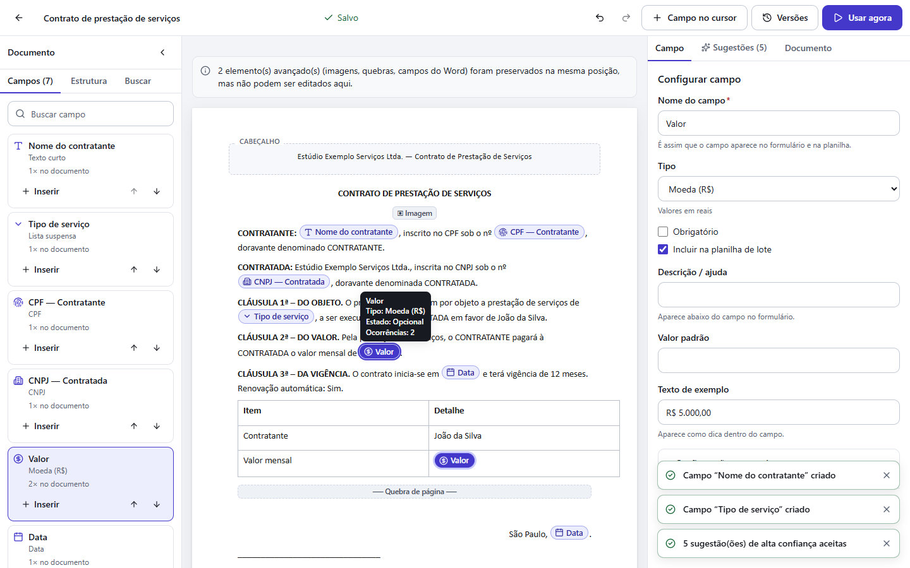
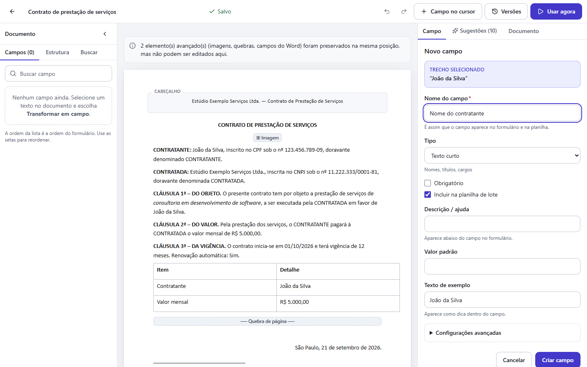
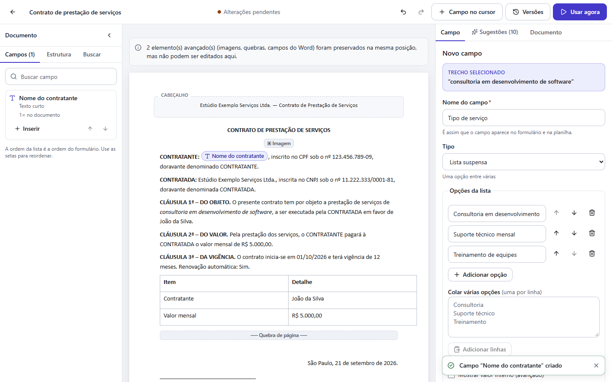
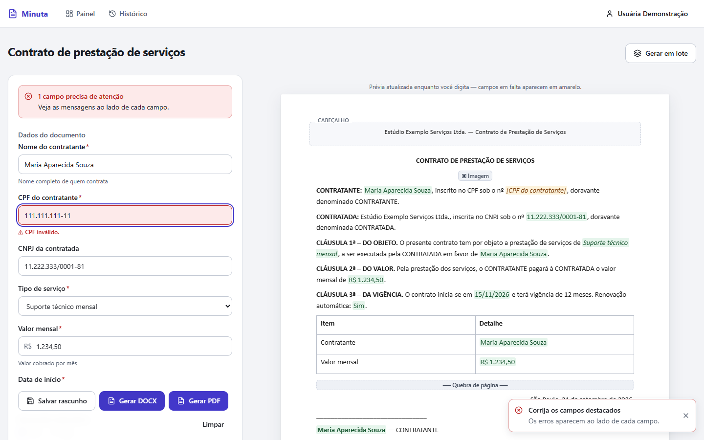
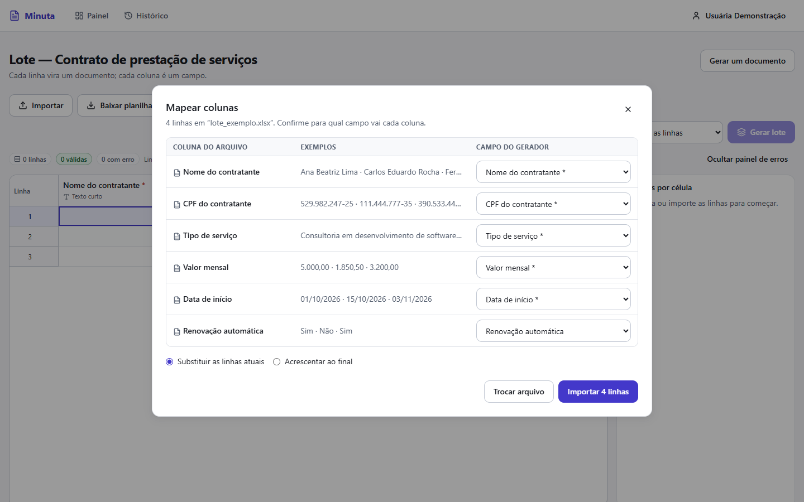
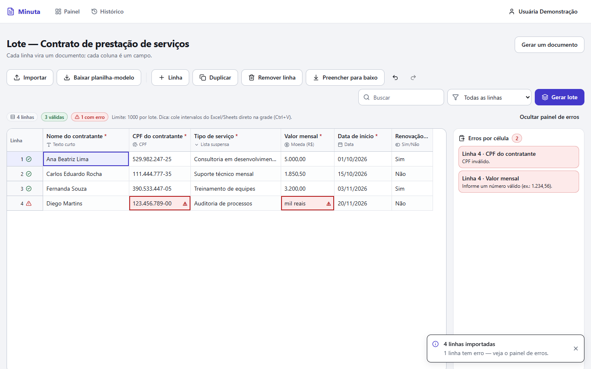
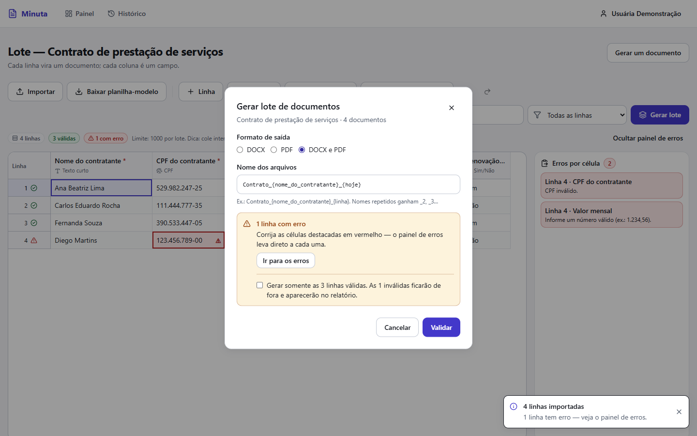
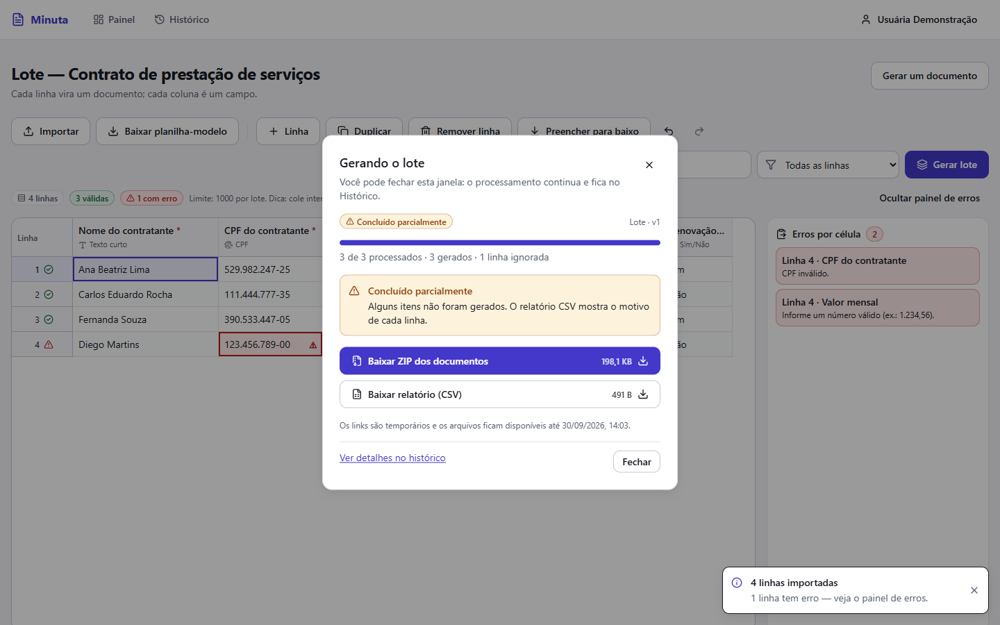
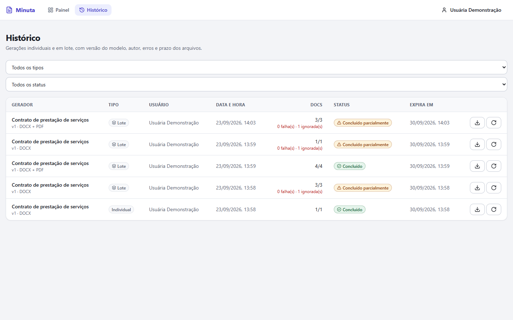

# Roteiro de demonstração

Pré-requisito: `docker compose up --build` concluído (ou o modo local do README). Arquivos de exemplo em `demo/` (dados **fictícios**).
Capturas de tela em `docs/screenshots/` (geradas por `CAPTURE_SCREENSHOTS=1 npx playwright test e2e/capture-screenshots.spec.ts`):

| | |
|---|---|
|  |  |
|  |  |
|  |  |
|  |  |
|  |  |


## Parte A — Criar um gerador (≈ 4 min)

1. **Criar conta** em http://localhost:3000/register (ou entre com `demo@minuta.app` / `demo12345` para ver um gerador já pronto).
2. **Novo gerador** → nome “Contrato de prestação de serviços” → **Continuar** → escolha `demo/contrato_prestacao_servicos.docx` → **Enviar e analisar**. A tela mostra o progresso e leva ao editor com a aba **Sugestões** aberta.
3. O documento aparece no editor: cabeçalho, corpo, **tabela**, rodapé, imagem e quebra de página (blocos cinza = preservados, não editáveis).
4. **Selecione “João da Silva”** (primeiro parágrafo) → surge o menu flutuante → **Transformar em campo** → no painel lateral digite **Nome do contratante** → **Criar campo**. O trecho vira um chip com ícone e tooltip (nome, tipo, estado).
5. Selecione outra ocorrência do nome (“em favor de João da Silva”) → **Transformar em campo** → abra **Ou usar um campo que já existe** → *Nome do contratante* (o mesmo campo é reutilizado; o painel mostra “N× no documento” e setas para navegar entre ocorrências).
6. Selecione “consultoria em desenvolvimento de software” → **Tipo: Lista suspensa** → cole em *Colar várias opções*:
   ```
   Consultoria em desenvolvimento de software
   Suporte técnico mensal
   Treinamento de equipes
   ```
   → **Adicionar linhas** → **Criar campo**. (Opções duplicadas são recusadas; dá para reordenar, renomear, definir padrão e valor interno.)
7. Aba **Sugestões** → **Aceitar alta confiança**: CPF, CNPJ, valor (2 ocorrências) e as duas datas do documento (corpo e assinatura) viram campos — como são datas diferentes, aparecem já numeradas ("Data 1", "Data 2"; ver [D26](DECISIONS.md)). Cada sugestão mostra trecho, nome/tipo, localização, confiança e origem (Regra / Heurística local / IA). Um nome de pessoa logo depois de "CONTRATANTE"/"CONTRATADA" ganha esse rótulo em vez de "Nome" genérico; uma palavra solta de mês vira lista suspensa com os 12 meses prontos; um ano de 4 dígitos isolado vira campo "Ano".
8. Observe o **indicador de salvamento** na barra superior (“Salvando… → Salvo”). Feche a aba com alterações pendentes: o navegador avisa. **Ctrl+Z** desfaz.
9. Sem etapa de publicação: salvar já deixa o gerador pronto. **Usar agora** abre o formulário na hora. **Versões** mostra o histórico e permite restaurar uma versão anterior; a estrela no painel **fixa** o gerador no topo.

## Parte B — Gerar um documento (≈ 2 min)

1. **Usar agora** → formulário gerado a partir dos campos (agrupados, com máscaras). Digite o CPF sem pontuação: a máscara aplica. Digite um CPF inválido e clique **Gerar DOCX**: o erro aparece **em texto ao lado do campo**.
2. A **prévia à direita** muda enquanto você digita; campos vazios ficam em amarelo.
3. Ajuste **Nome do arquivo** (`Contrato_{nome_do_contratante}_{hoje}`), clique **Gerar DOCX** e depois **Gerar PDF**. O diálogo acompanha o job e oferece o download (link assinado, curto).
4. Abra o DOCX/PDF: o nome aparece em todas as ocorrências, formatação, tabela, cabeçalho/rodapé, imagem e quebra de página preservados.

## Parte C — Lote estilo planilha (≈ 4 min)

1. No painel, menu do gerador → **Gerar em lote**.
2. **Digite** 3 linhas direto na grade (Tab/Enter/setas navegam; F2 edita; CPF/moeda/data recebem máscara; a coluna de lista abre um seletor).
3. **Cole** um intervalo copiado do Excel/Sheets (Ctrl+V) — a colagem preenche várias colunas/linhas e cria linhas novas se precisar. **Ctrl+D** (ou o botão) preenche para baixo.
4. **Importar** → `demo/lote_exemplo.xlsx` → confira o **mapeamento** (colunas reconhecidas por nome; você pode trocar/ignorar) → **Importar 4 linhas**. Uma linha vem inválida de propósito (CPF com dígito errado e valor “mil reais”).
5. Contadores mostram **3 válidas / 1 com erro**; as células ficam destacadas em vermelho com ⚠ e texto. No **painel de erros**, clique em um item para ir direto à célula e corrija (ex.: CPF `39053344705`, valor `1500`). Se uma célula de lista suspensa trouxer um valor que ainda não existe nas opções do campo, a importação para num passo extra perguntando se quer **adicionar essa opção** (mostra as opções atuais) antes de seguir para a grade — ver [D26](DECISIONS.md).
6. **Baixar planilha-modelo** gera um `.xlsx` com cabeçalhos, listas suspensas, validações e aba “Instruções”.
7. **Gerar lote** → escolha **DOCX e PDF** → o servidor **valida de novo** → o job roda em background com barra de progresso (você pode fechar o diálogo). Se restarem linhas inválidas, só dá para gerar “somente as válidas” após **marcar a confirmação explícita**.
8. Ao final: **ZIP** com os documentos + **relatório CSV** (status por linha).

## Parte D2 — Kit de documentos (≈ 3 min)

Use dois geradores prontos que compartilham variáveis — por exemplo, duplique o gerador "Contrato de prestação de serviços" (menu → **Duplicar**) para simular um segundo documento com os mesmos campos "Nome do contratante" e "CPF".

1. **Kits** (menu superior) → **Novo kit** → nome "Kit de admissão" → **Continuar**.
2. **Adicionar documento** → escolha os dois geradores, um de cada vez (o diálogo só lista geradores com `.docx` já enviado).
3. **Detectar automaticamente**: campos com rótulo igual ou quase idêntico entre os dois documentos (ex.: "Nome do contratante", "CPF") viram **campos compartilhados** do kit automaticamente; campos que só existem em um dos documentos continuam preenchíveis normalmente, só nele. Ajuste o mapeamento na grade se algum campo não tiver sido detectado (rótulos diferentes não são reconhecidos sozinhos — mapeie manualmente).
4. **Usar agora**: um único formulário reúne os campos compartilhados (preenchidos uma vez) e, abaixo, os campos exclusivos de cada documento (se houver). **Gerar kit (N documentos)**.
5. O diálogo acompanha o progresso de cada documento (reaproveita o mesmo runner/histórico dos jobs individuais — cada documento do kit aparece também no **Histórico**). Ao terminar: baixe **cada documento separadamente** ou **tudo em ZIP**, além do **relatório CSV** com o status de cada um.

## Parte D — Histórico e isolamento

1. **Histórico**: gerador, versão, tipo, usuário, data/hora, quantidade, status, erros por linha, prazo de expiração dos links; **Repetir** refaz com os mesmos dados (membro só repete o que ele gerou).
2. Entre com `outra@minuta.app` / `demo12345` (outro workspace): não vê nada do primeiro. Testes automatizados verificam isso em 28 chamadas e no download assinado.

## Verificações de robustez (opcional)

- **Itens com erro não derrubam o lote**: a linha inválida/que falha vira `failed` (com código e mensagem no histórico e no `relatorio.csv`) e o job termina `partial`.
- **Queda do worker no meio do lote**: gere um lote grande em **DOCX e PDF** (≈ 400 linhas), e enquanto a barra avança mate o worker de verdade e religue-o:
  ```bash
  docker kill minuta-worker-1          # SIGKILL: o job fica parado em "Processando"
  docker compose -p minuta start worker
  ```
  Automatizado (cria o lote, mata, religa, espera e confere duplicatas): `python scripts/crash_recovery_test.py`.
  Em ≈ 1 a 1,5 min o watchdog percebe o heartbeat velho, reenfileira o job e a barra volta a andar até 100 %, **sem arquivos duplicados** (verificado: 400/400, 2 tentativas, 400 DOCX + 400 PDF + 1 ZIP + 1 relatório).
- **Idempotência**: clique duas vezes em “Gerar lote”/“Gerar DOCX” (ou repita `POST` com o mesmo `Idempotency-Key`): só um job é criado.
- **Métricas**: `curl http://localhost:8100/metrics` · **Saúde**: `curl http://localhost:8100/ready`.
